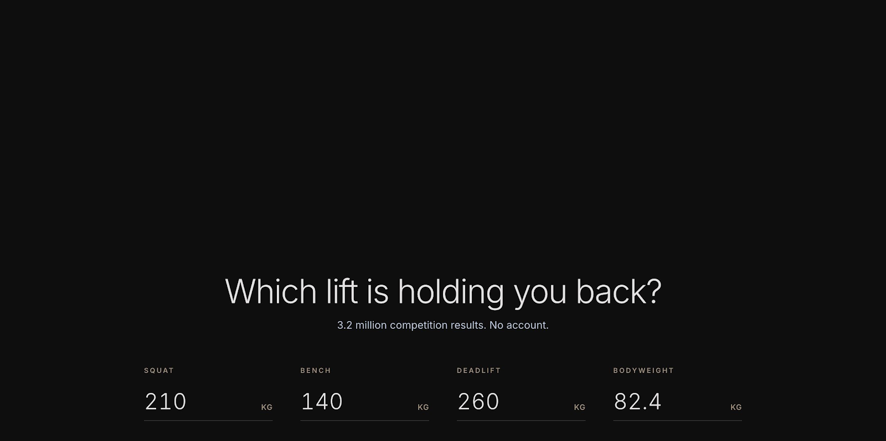
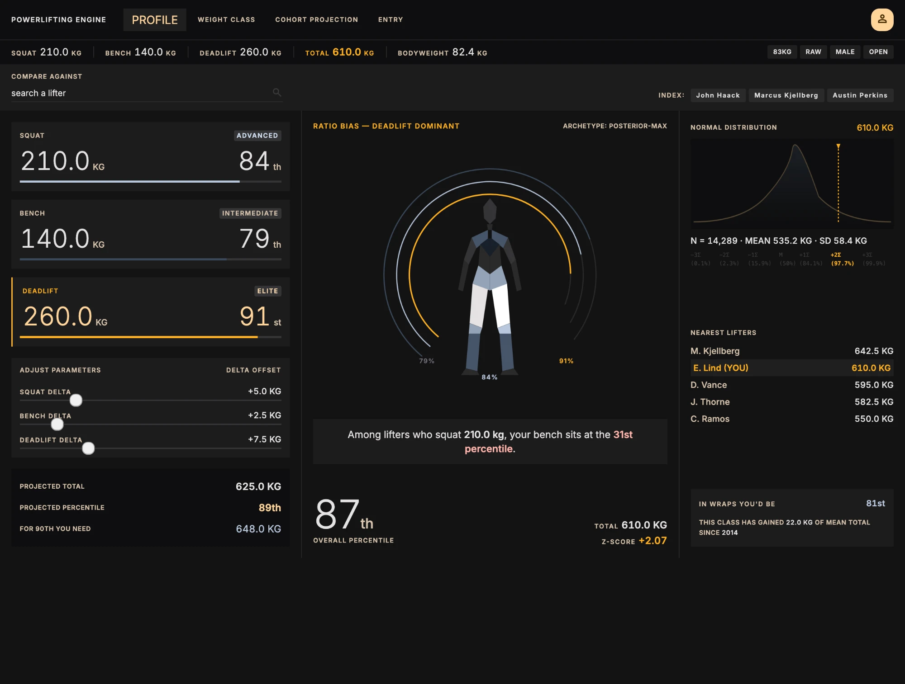
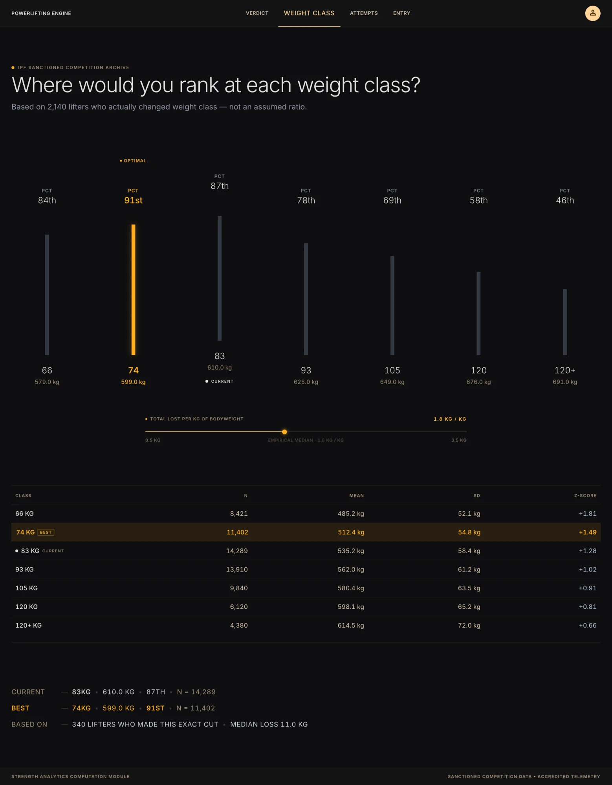
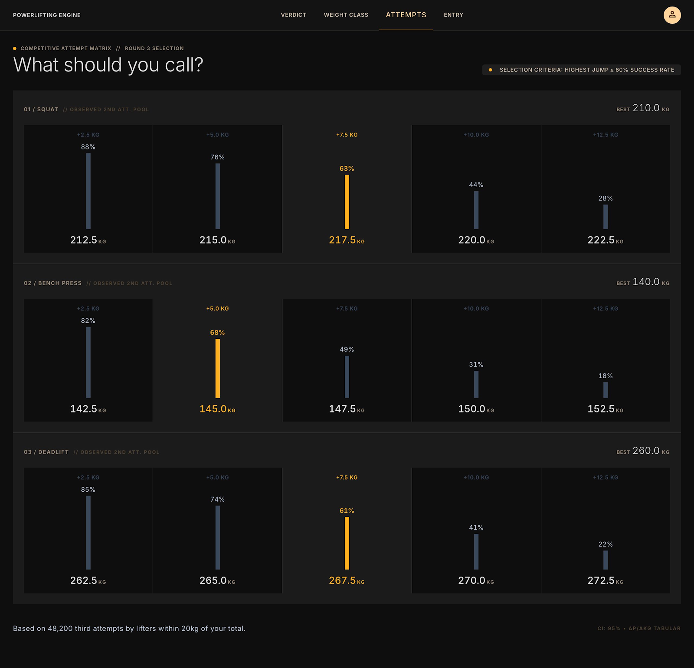
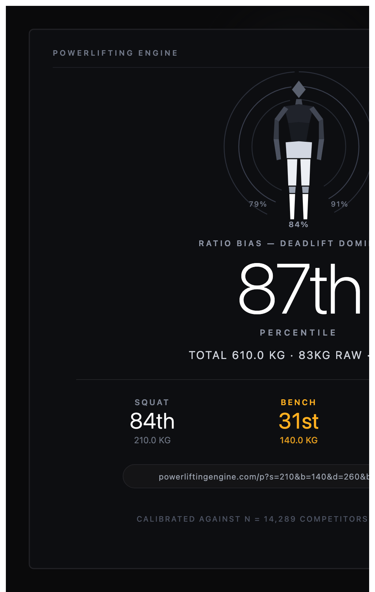

# Frontend build spec

Reconciles three sources that disagree: `powerlifting-build-spec.md` (Part 3–4), the eight
mockups, and the API as actually built. Where they conflict this document wins, and says
why.

Mockups live in `docs/mockups/`. Each screen section below embeds the one it implements;
annotations under each image say what in it is wrong, missing or unsupported.

---

## 1. Scope

**Building:** Entry · Verdict · Weight Class · Attempts · Share card.

**Not building yet:** Head to Head (`mockups/head-to-head.png`), Leaderboards
(`mockups/leaderboards.png`), Explore (`mockups/explore.png`). Each is blocked on engine work
that was cut or never started — `nameLookup` and `lifterByName` for Head to Head,
`Expression`/`SortKey` for the Leaderboards composer, the parser and the
`rowsScanned`/`blocksSkipped` instrumentation for Explore. They appear in the nav as
disabled tabs, not as links to empty pages.

This is the build spec's own advice: *"Stop after 5 and you have a complete, shippable
product."* Steps 1–5 of its build order are exactly these five screens.

---

## 2. API gaps that must close first

Three, in order of size. None is large; all block a screen.

### 2.1 Per-bucket success rate — blocks Attempts

**This is the real one.** The Attempts screen shows five jump cards per lift, each with
*the success rate at that jump size*. The current `Attempts` RPC returns one aggregate
`success_rate` for the whole group, plus `jump_bins` giving **how many people jumped that
much** — not **what fraction of them made it**. Those are different numbers and the screen
needs the second.

The spec's own definition of Q8 says so: `groupBy: jumpBucket, agg: SuccessRate`.

Fix, roughly 20 minutes: `attempts()` already walks every jump in pass 3 to bin it. Carry
the success flag alongside the jump and increment a second counter in the same place.

```cpp
// pass 1 collects (jump, succeeded) rather than jump alone
struct Jump { float delta; bool ok; };

// pass 3
++counts[idx];
if (j.ok) { ++successes[idx]; }
```

Proto: `Bin` gains a field (append, don't renumber), or `AttemptsResponse` gains a parallel
`repeated uint32 bin_successes`. Prefer the field on `Bin` — it keeps the count and its
success together and can't be mis-indexed.

Then `success_rate` for a bin is `success_count / count`, and the aggregate
`success_rate` stays as the headline number.

### 2.2 Inverse percentile (Q3) — blocks Verdict 2.5

"FOR 90TH YOU NEED 648.0 KG" in the mockup. `value_at_percentile` was specified, never
built. `rank_index_at()` already exists and is the whole convention, so this is a thin
wrapper over `find_index` plus one index:

```cpp
float PercentileIndex::value_at_percentile(Sex, Equipment, Event, std::uint8_t,
                                           LiftKind, double pct) const;
```

**Close Q5's open cross-check in the same pass** — `value_at_percentile(…, 0) == 70.0` and
`(…, 100) == 582.5` for the known group, which tests the clamping in both directions with
no new constant.

### 2.3 Dataset meta (Q9) — blocks Entry 1.6

"3.2M LIFTS · 48 FEDERATIONS · 14ms QUERY TIME". A `Meta` RPC returning total row count and
distinct federation count. Both are known at load; expose them off `ColumnStore` —
`store.size()` and `federation_dict.size()`.

The "14ms" number is instrumentation that doesn't exist. Replace it with the real measured
query time from the README's benchmark table as a static value, or drop the third stat.
**Do not invent a latency readout.**

---

## 3. Reconciliation — where the sources disagree

### 3.1 The mockups break the spec's own banned-vocabulary rule, five times

| Where | Rendered | Problem |
|---|---|---|
| Verdict | `ARCHETYPE: POSTERIOR-MAX` | "archetype" is on the banned list |
| Verdict | `NORMAL DISTRIBUTION` | implies a fitted model you don't compute |
| Weight Class footer | `ACCREDITED TELEMETRY` | both words banned |
| Attempts footer | `CI: 95%` | confidence intervals are banned *and* not computed |
| Share card | `CALIBRATED AGAINST N = 14,289` | "calibrated" is banned |

Replacements: drop the archetype line entirely (the ratio-bias line beside it already says
the same thing with real numbers); `DISTRIBUTION`; `OPENPOWERLIFTING · IPF SANCTIONED`;
delete the CI line; `MEASURED AGAINST N = 14,289 RESULTS`.

### 3.2 The σ axis shows textbook normal values, not this data

The Verdict mockup labels the axis `−3Σ (0.1%) −2Σ (2.3%) −1Σ (15.9%) M (50%) +1Σ (84.1%)
+2Σ (97.7%) +3Σ (99.9%)`. Those are the normal distribution's percentages. **Your data is
visibly right-skewed — the curve drawn in the mockup is itself skewed** — so at +2σ the real
percentile is not 97.7%.

You have the real numbers: the bins give the empirical CDF, so the percentile at
`mean + kσ` is a lookup. Use those, and the σ marks already carry `in_range` for the ones
that fall outside the data.

This is the one change on this list that affects credibility rather than taste: a number
that doesn't trace to the dataset is exactly what the spec's done-check forbids.

### 3.3 Three different nav bars

The spec says seven tabs; the Verdict mockup says `PROFILE · WEIGHT CLASS · COHORT
PROJECTION · ENTRY`; the Weight Class and Attempts mockups say `VERDICT · WEIGHT CLASS ·
ATTEMPTS · ENTRY`.

**Settle on:** `VERDICT · WEIGHT CLASS · ATTEMPTS · ENTRY`, with `HEAD TO HEAD ·
LEADERBOARDS · EXPLORE` present and dimmed. Matches two of the three mockups and the
screens that exist.

### 3.4 Seven weight classes drawn, nine returned

The mockup shows 66/74/83/93/105/120/120+. The engine returns nine per sex (men add 53 and
59; women 43 and 47). `ClassSweep` returns all nine including empty ones, deliberately.

**Render all nine.** The layout scales, the thin classes are honest, and dropping rows
server-side was explicitly rejected. If 53/59 are visually noisy at n≈200, grey them — don't
remove them.

### 3.5 "Normal distribution" is a histogram

The engine returns 52 bins, not a fitted curve. Draw a smooth path through the bin
midpoints (Catmull-Rom, or a simple quadratic smoothing) — that's presentation of real
counts and it's fine. Labelling it "normal" is not.

---

## 4. Stack

| | | |
|---|---|---|
| Build | **Vite + React + TypeScript** | |
| Types | **generated from `engine.proto`** (`buf generate` + protobuf-es) | the proto has already lost an RPC once; hand-written types would drift silently |
| Charts | **hand-rolled SVG, no library** | every figure in the mockups is too specified for a library's defaults — the distribution path, the seven-bar sweep, the jump cards, the three arcs. The bins are already `{low, high, count}`; that is a `<path>` |
| Routing | `react-router` or a 40-line hash router | five screens |
| State | **URL is the state**, per Part 5 of the build spec | |
| Fonts | Inter, `font-variant-numeric: tabular-nums` globally | |

No state library. The URL holds the inputs; everything else is derived from one `SUBMIT`
fetch.

---

## 5. Data layer

### 5.1 The fetch model

Three refresh classes from the build spec, implemented as:

- **BOOT** — `Meta`, once, cached in a module-level promise.
- **SUBMIT** — on Analyse or any filter change. Fires every RPC the screen needs **in
  parallel**, one `Promise.all`. For Verdict that is `Percentile` ×3 (squat/bench/deadlift),
  `Percentile` ×1 (total, which also carries `neighbours` and `rank`), `Distribution`,
  `ConditionalPercentile` ×2, `EquipmentSwap`, `ClassTrend`, `ClassSweep`, `ClassChange`.
- **LIVE** — **no network at all.** See below.

### 5.2 LIVE without requests

The build spec budgets 8 ms per drag frame for widgets 2.4–2.9. Over HTTP that is not
achievable and a debounce would break the "zero transition delay" requirement.

**It doesn't need a request.** `Distribution` already returns 52 bins, which is the
empirical CDF of the group. On SUBMIT you have it. During a drag:

```
percentileOf(total) = interpolate within the bin containing `total`
                      using cumulative counts either side
```

Pure arithmetic, sub-millisecond, no network. The projected total, the projected
percentile, the hero percentile and the figure's lighting are all functions of that one
number, so the whole LIVE set falls out of a single local lookup.

Build a `Cdf` object once per SUBMIT:

```ts
type Cdf = {
  bins: { low: number; high: number; count: number }[];
  cumulative: number[];   // prefix sums, length bins.length + 1
  n: number;
  percentileAt(value: number): number;   // linear within the bin
  valueAt(percentile: number): number;   // the inverse, for the slider's targets
};
```

`valueAt` also covers the "FOR 90TH YOU NEED" line during a drag; the server's Q3 is the
authoritative value shown on SUBMIT, and the interpolation is what moves while dragging.
**Note in the UI when they differ by more than a bin width** — they shouldn't.

### 5.3 Client shape

One module, no hooks library:

```
src/api/
  client.ts      fetch wrapper: base URL, error envelope -> typed Error
  endpoints.ts   one function per RPC, typed in and out
  cdf.ts         the Cdf object above
  queryKeys.ts   so SUBMIT dedupes identical requests
```

Errors come back as `{error: {code, message}}` with the engine's own wording for 4xx.
**Surface that message**, don't replace it — the whole fail-loud chain exists so the user
learns the real limit. A 503 means the engine is down; show that distinctly from a 400.

---

## 6. Design tokens

```css
:root {
  --bg:         #0A0A0B;
  --surface:    #141416;
  --line:       #222226;
  --text:       #F5F5F7;
  --text-dim:   #86868B;
  --text-faint: #52525A;
  --accent:     #FFB020;
  --danger:     #FF6B6B;

  --figure-weak:   #3D4450;
  --figure-mid:    #8B93A1;
  --figure-strong: #F5F5F7;
}
```

Type scale: Hero 96/300 · Large 48/300 · Stat 28/400 · Label 11/500 uppercase 0.14em ·
Body 14/400. Radius 2–4px. Borders 1px only. Spacing base 8px.

**One amber per screen, on the highest-value item only.** The Verdict mockup breaks this —
it uses amber on the deadlift panel, the total in the header, the projected percentile, the
distribution marker, the equipment-swap figure, *and* a second accent (pink `#FF6B6B`) on
the verdict sentence. Pick one: amber on the verdict sentence's lowest percentile, since
2.9 is the product. Everything else goes to `--text`.

---

## 7. Shared components

```
<TopNav active />                 tabs, dimmed for unbuilt screens
<HeaderStrip lifts total bw chips />
<Eyebrow>IPF SANCTIONED COMPETITION ARCHIVE</Eyebrow>
<Headline> <Subtitle>
<Stat label value unit />         tabular-nums, unit at Label size
<PercentileBar value />           hairline track, filled to percentile
<DistributionChart cdf marker sigmaMarks />
<Figure percentiles={{squat,bench,deadlift}} />
<Arc percentile position />       thin, open at bottom
<Slider value onChange min max />  zero transition
<Footer />
```

### The figure

The only asset not derivable from data, and it appears on Verdict and the share card. From
the mockups it is a low-poly humanoid with separable regions: head, shoulders/arms, chest,
torso, hips, thighs, shins, feet.

**Author it once as an SVG with `id`s per region**, then recolour by relative percentile:

```
chest, shoulders  <- bench
back, hips        <- deadlift
thighs, shins     <- squat
```

Lit by **relative** percentile — each lift's percentile normalised against the other two,
not against the population — otherwise a strong lifter glows uniformly and the screen's
whole point disappears. The build spec's done-check is explicit: *"the figure's chest is
visibly dimmer than its back"*.

Interpolate `--figure-weak → --figure-mid → --figure-strong` across the relative range.

---

## 8. Screens

### Screen 1 — Entry



*Crop only shows the headline and the four inputs. Filter chips, the Analyse button and
the stats row sit below the fold of this capture — build them from the widget table in
`powerlifting-build-spec.md` §4.1. The stats row's "14ms QUERY TIME" is the invented
latency readout from §2.3.*

No nav. Headline, subtitle, four underline inputs (squat · bench · deadlift · bodyweight,
KG suffix right, uppercase label above), filter chips (sex · equipment · age class), Analyse
button, stats row from `Meta`.

**Validation**, inline beneath the offending field in `--danger`, cleared on edit: non-numeric
rejected · bodyweight 30–250 · each lift 0–600 · all four required. Do not advance until
valid.

Prefill from `localStorage` **wrapped in try/catch** — it must work with storage blocked.

### Screen 2 — Verdict



*Five things in this image do not survive into the build. `ARCHETYPE: POSTERIOR-MAX` —
banned word, and the ratio-bias line beside it already says it with real numbers. `NORMAL
DISTRIBUTION` — it's a histogram. The σ-axis percentages are the normal table's, against
data the drawn curve shows is skewed. `COMPARE AGAINST` with its three name chips needs
`nameLookup`, which doesn't exist — cut the whole strip. And amber appears six times plus a
second pink accent on the sentence; it gets one.*

*Also note the nav here reads `PROFILE · WEIGHT CLASS · COHORT PROJECTION · ENTRY`, which
matches neither the other mockups nor the spec — see §3.3.*

Three columns. Left: three lift panels (kg large, percentile large beside, tier word, bar),
three delta sliders, projection block. Centre: ratio-bias line, figure with three arcs,
verdict sentence, hero percentile with total and z-score. Right: distribution, nearest
lifters, equipment swap, class trend.

**Bindings**

| Widget | Source |
|---|---|
| lift panels | `Percentile` ×3, one per lift |
| tier word | derived from percentile: <40 NOVICE · <70 INTERMEDIATE · <90 ADVANCED · ≥90 ELITE |
| sliders → projections | **local `Cdf`**, no request |
| figure + arcs | the three lift percentiles, normalised relative to each other |
| ratio bias | the highest relative lift: `DEADLIFT DOMINANT` etc. |
| verdict sentence | `ConditionalPercentile`, condition = strongest lift, target = weakest |
| hero percentile | `Percentile` on total |
| z-score | `(total − summary.mean) / summary.sd` from `Distribution` |
| distribution | `Distribution` bins + real σ-mark percentiles (§3.2) |
| nearest lifters | `Percentile`'s `neighbours`, **k = 4**, with the user's own row inserted at their position → five rows, two either side |
| equipment swap | `EquipmentSwap`, raw → wraps |
| class trend | `ClassTrend`, mean of the latest year minus mean of 2014 |

**Names come back in full** (`Marcus Kjellberg`); abbreviate to `M. Kjellberg` client-side.
Keep the full name in a `title` attribute.

**The verdict sentence is the largest element on the screen.** If it isn't, the screen has
failed — that is the spec's check and it is correct.

### Screen 3 — Weight Class



*Seven bars drawn, nine returned — render all nine (§3.4). The footer's `ACCREDITED
TELEMETRY` is two banned words. Everything else here maps cleanly onto `ClassSweep` +
`ClassChange` + `Distribution`, and the bar/table/summary structure is the clearest in the
set — build this screen second after Verdict.*

Eyebrow, headline, subtitle citing `ClassChange.lifters` ("Based on 2,140 lifters who
actually changed weight class — not an assumed ratio"), nine bars, loss-per-kg slider,
population table, summary lines.

| Widget | Source |
|---|---|
| bars | `ClassSweep` with `value` = projected total at each class |
| projected total per class | `total − (bw − classLimit) × lossPerKg` |
| loss-per-kg default | `ClassChange.mean_total_delta / mean bodyweight delta` — the empirical median marked on the track |
| slider | **LIVE, local only** — recompute projected totals, then percentile from each class's `Cdf` |
| table | `ClassSweep` rows: class · n · mean · sd · z-score |
| summary | current row, best row, and `ClassChange.lifters` + median loss |

The slider needs a `Cdf` per class, so SUBMIT fetches `Distribution` ×9 in parallel. Nine
lookups at ~1.5 µs each server-side; the cost is nine HTTP round trips, which is why they go
in one `Promise.all`.

### Screen 4 — Attempts



*Every percentage in this image — 88%, 76%, 63%, 44%, 28% — is a success rate **per jump
bucket**, and that is the number the API does not currently return. This mockup is what
made §2.1 visible. The footer's `CI: 95% · ΔP/ΔKG TABULAR` goes; so does the "within 20kg
of your total" claim in the footnote, which describes a filter the engine doesn't apply.*

**Blocked on §2.1.** Once that lands: three lift sections, five jump cards each
(+2.5/+5/+7.5/+10/+12.5), success % above a bar, resulting weight below. Optimal = the
largest jump with success ≥ 60%, in amber.

The engine's bins are computed from the data's actual min/max and include negative jumps.
**Select the five buckets client-side** by filtering on `low` ∈ {2.5, 5, 7.5, 10, 12.5}, and
if a bucket is missing, render the card empty rather than shifting the others.

Footnote from the response's `n`: "Based on 48,200 third attempts by lifters within 20 kg of
your total." **That 20 kg claim is not what the engine does** — `Attempts` filters by weight
class, not by total proximity. Either change the sentence to say weight class, or add the
filter. Changing the sentence is correct and free.

### Screen 8 — Share card



*Capture is cropped at the right edge. `CALIBRATED AGAINST N = 14,289 COMPETITORS` becomes
`MEASURED AGAINST N = 14,289 RESULTS` — and note "competitors" is wrong twice over, since
`n` counts results, not people. The amber on `BENCH 31st` is the correct single use: the
weakest lift is the point of the card.*

Square canvas, no queries, composed from what Verdict already holds: figure, hero
percentile, total, class/equipment, three lift percentiles with the lowest in amber, the
URL, and the N line (§3.1 wording). Must be readable at phone size — test at 320 px wide
before calling it done.

---

## 9. State

URL carries everything; no session.

```
/                                              entry
/v?s=210&b=140&d=260&bw=82.4&sex=m&eq=raw&age=open
/wc?…&loss=1.8
/at?…
```

`localStorage` holds only the last-entered numbers, for prefill, every access in try/catch.

---

## 10. Build order

1. **Close §2.2 and §2.3** (Q3, Q9) — 1 h, unblocks Entry and Verdict's projection block.
2. **Shell**: tokens, `TopNav`, `HeaderStrip`, `Footer`, routing, the API client and
   generated types. Nothing renders data yet.
3. **Entry**, end to end with validation and `Meta`.
4. **Verdict without the figure** — panels, distribution, nearest, swap, trend, and the
   verdict sentence. *This is the product; get the sentence right before anything else.*
5. **`Cdf` + sliders** — the LIVE set, measured. Record the frame time.
6. **The figure and arcs.**
7. **Weight Class.**
8. **Close §2.1, then Attempts.**
9. **Share card.**

Stop anywhere after 5 and you have something coherent.

---

## 11. Done checks

Per screen, from the build spec and still correct:

- Under ~12 labels
- Every number traces to a dataset column or a computation on one
- No banned vocabulary — and this document lists five to remove from the mockups
- Amber appears once
- One typeface, tabular figures

Verdict specifically:

- The verdict sentence is the largest text on screen
- The figure's chest is visibly dimmer than its back
- Sliders have zero transition delay
- Dragging holds frame rate — measure it, don't assume it

Added here:

- Every σ-axis percentage comes from the bins, not from a normal table
- A 4xx from the engine shows the engine's own message
- The page works with `localStorage` blocked
- The share card is legible at 320 px

---

## 12. As built (2026-11-06)

Where the build departs from this spec, and why. Every item came from the data or the API.

- **§2.1 closed**: `Bin.successes` (field 4). Measured rates do *not* fall with jump size:
  M/Raw/SBD 83 kg squat reads 59 / 64 / 70 / 68 / 67 % for +2.5 … +12.5. Lifters choose big
  jumps on good days, so these are rates for chosen jumps, not odds, and the screen says so.
  "Largest jump ≥ 60 %" therefore usually picks +12.5; a bucket needs n ≥ 30 to be picked.
- **§2.3**: `DatasetStats` counts placed results with a total (3,748,104), not raw rows, and
  takes optional filters. The stats row's third item is the benchmarked 8.8 ms, labelled as such.
- **Loss per kg**: `ClassChange` gained `median_total_per_bw_kg`, `median_bw_delta` and
  `bw_transitions`. Measured medians, total change per kg of bodyweight: men moving down **0.0**,
  women moving down **−1.2**; moving up +5.6 / +4.4, which includes training between meets.
  The mockup's 1.8 has no source in this data. The slider defaults to the measured value.
- **Weight Class reach**: the rate comes from one-class moves (median ~5 kg), so only your own
  class and its neighbours can be BEST; further classes are drawn faint. Without this, 0 kg/kg
  puts an 83 kg lifter's total in 53 kg at the 100th percentile.
- **Verdict type**: the hero percentile is 40 px so the sentence (42 px) is the largest text,
  per the done-check. The verdict sentence needs the strongest/weakest lift first, so it is one
  extra round trip after the parallel batch.
- **Nearest lifters**: the engine's k stays 5 (2 below, 3 at-or-above); the client keeps 2 a
  side and inserts the user. No engine change.
- **Entry**: no age-class chip. No RPC filters by age, so the chip would change nothing.
- **Attempts amber**: one per lift section (the pick), as this spec's Attempts section says —
  which is three per screen, against §6's "amber once".
- **Measured**: slider update 1.1 ms median, 1.9 ms p95 (React dev build), zero requests during
  a drag. Share card legible at 320 px; PNG export rasterises with no unresolved CSS variables.
- **Colour and motion (2026-11-06, on request)**: departs from §6's grey palette and "amber
  once". Each lift has a hue used everywhere it appears — squat `#2FD4C1`, bench `#8F7BFF`,
  deadlift `#FF7A59` — and the figure is lit in those hues, brightness still by *relative*
  percentile. Amber stays reserved for the answer (verdict percentile, best class, the pick,
  the weakest lift on the share card). Motion plays on arrival only (count-up, bars growing,
  paths drawing, staggered rise) and is off under `prefers-reduced-motion`. Nothing a slider
  drives is animated or transitioned, so the zero-delay check still holds: production build,
  0.2–0.3 ms median and < 1 ms p95 per slider update, no requests.
  Interactions: hover a lift panel or a body region to spotlight that lift; hover the
  distribution for kg + percentile at the cursor; click a weight class (bar or row) to see
  how its number is computed; click an attempt card to call it.
- **Head to Head and Leaderboards built (2026-11-06), without name search** (by request).
  Engine: `Leaderboard` (one line per lifter — their best-total result in the class — ranked by
  a preset or `a [minus|plus|ratio] b` over {lift} × {kg, percentile}, plus where "you" would
  rank) and `LifterByName` (best total in a category, optionally within one class). DOTS uses
  OpenPowerlifting's formula, which reproduces the dataset's column to the hundredth.
  Opponents are picked from the top of your class, the lifters just above your total, or any
  Leaderboards row. Head to Head defaults to the opponent's best **in your class**: John
  Haack's best overall is a 105 kg total, which against an 83 kg cohort reads 100th on every
  lift. "Fastest progression" is not offered; the engine keeps no per-lifter history query.
  Known data issue: percentile-gap rankings surface mis-recorded meets (e.g. a 25 kg squat
  beside a 292.5 kg deadlift); the screen says so rather than silently filtering.

- **Implausible-line filter** (on by default, toggle on Leaderboards): drops lifters whose best total has one lift under 15% of it; 113 in 83 kg raw men, matched by awk. Your own line is never hidden.
- **Verdict sentence scale**: `ConditionalPercentile` returns `target_median`; the screen shows "their median bench is 115.0 kg; yours is 60.0 kg", says the group spans all weight classes, and prints anything under 1% as "<1st" (floored to "0th" it read as a bug). Pinned against awk in `conditional_percentile_test.cpp`.
- **Share card QR**: encodes this lifter's Verdict URL; drawn as SVG rects so the PNG export keeps it, verified by decoding the exported PNG. In dev it points at localhost; deployed, at the real host.
- **Verdict in plain language (2026-11-07)**: `ConditionalPercentile` takes an optional `ipf_class` ("lifters your size"), falling back to all classes below 500 results (`all_classes` says which), and returns the target lift in 5 kg bins. The screen leads with "Your bench is what's holding you back" / "a little behind" / "in balance" (share below < 25% / < 45% / otherwise), then counts ("less than all 3,272 of them", "27 in 100 of them squat less"), a strip chart with you and the typical value, a chip naming the group, and what reaching the typical value does to the class percentile. In-class numbers pinned against awk.
- **Share card, redesigned (2026-11-07)**: poster layout -- huge overall percentile, the verdict
  in first person ("Bench is holding me back."), three lift bars in their hues, a glow in the
  strongest lift's colour, film grain against PNG banding, QR top right. The QR uses
  `VITE_PUBLIC_URL` when set (domain printed on the card); otherwise, in dev, the machine's LAN
  address (not printed), and the dev server listens on the LAN so a phone can open it.
- **Leaderboard fixes (2026-11-07)**: the composer's URL keys are prefixed `r` (`ra`, `rb`, ...);
  an unprefixed `b` (second operand) overwrote the lifter's bench, so every filter change emptied
  the page. `toQuery` now throws on any key that collides with a lifter input. One unit for both
  operands ("deadlift minus squat in percentiles"); ratios are kg/kg only. Explore tab removed.

- **No coloured edge stripes (2026-11-07)**: lift panels show a 25-tick percentile ruler (lit to the value, the current tick raised) instead of a side stripe plus thin bar; Attempts sections get a faint top wash in the lift hue; the "you" leaderboard row keeps only its tint and badge. Slider updates in production: 0.2–0.4 ms median, ≤ 1.3 ms p95.
- **Mobile and tablet (2026-11-07)**: phones (≤ 760 px) get a bottom tab bar (Verdict · Classes · Attempts · Versus · Ranks; the logo goes to Entry), a sticky one-line header with an Edit link, the verdict statement first, Weight Class bars and Attempts cards laid flat as rows, swipeable leaderboard presets, and Head to Head with the comparison above the two lifter cards. Tablets (≤ 1100 px) put the verdict on top over two columns and tighten the tabs. Touch devices get 26 px slider thumbs, ~40 px tap targets, and nothing hover-only. No sideways scroll on any screen at 320, 375 or 768 px (measured).
